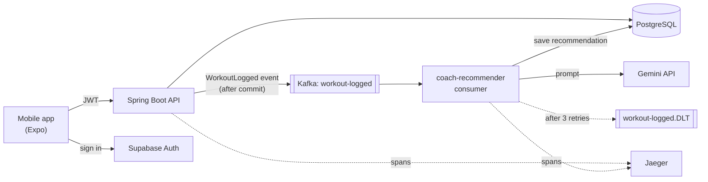

# CaliTrack

[](https://github.com/Vish2501/CaliTrack/actions/workflows/ci.yml)

A workout tracker in the style of Strong and Hevy: a React Native app backed by a Spring Boot API.
You log workouts and sets, review your history and training trends, and get AI coaching that is
generated in the background after each workout through Kafka.

| Workouts | Workout details | History | Profile |
|---|---|---|---|
|  |  |  |  |

## Stack

- **Mobile:** React Native, Expo SDK 57, TypeScript, NativeWind, React Navigation
- **Backend:** Java 17, Spring Boot 3, Spring Data JPA, Spring Security (JWT resource server), Flyway
- **Data and messaging:** PostgreSQL, Apache Kafka (KRaft)
- **AI:** Google Gemini, free tier, through its OpenAI-compatible API
- **Observability:** Micrometer Tracing, OpenTelemetry, Jaeger
- **Auth:** Supabase (the app signs in; the API validates the JWT)
- **Testing and delivery:** JUnit 5, Mockito, Testcontainers, GitHub Actions, Docker, Render

## How it fits together



1. Finishing a workout saves it and, once the transaction commits, publishes a `WorkoutLogged`
   event keyed by user ID. The request returns straight away.
2. The `coach-recommender` consumer builds a prompt from the user's last five workouts and their
   coach profile, calls Gemini, and saves one recommendation per workout.
3. The app asks for the latest recommendation and shows "generating…" until it arrives.
4. The request, the Kafka hop and the consumer share one trace ID, visible in Jaeger.

## What runs where

| | Docker Compose (local) | Production (Render) |
|---|---|---|
| API and PostgreSQL | ✅ | ✅ (Supabase Postgres) |
| Kafka-backed coach | ✅ | Off: Render's free tier has no Kafka, so the coach runs on request |
| AI model | Gemini if `GEMINI_API_KEY` is set, otherwise labelled demo replies | Gemini |
| Tracing | Exported to Jaeger | Trace IDs in logs only |

## Design decisions and trade-offs

- **The AI call is asynchronous.** Gemini is slow and can fail, so it runs in a Kafka consumer instead
  of on the request. Events are published only after the database commit, so a rolled-back workout
  never triggers one. The trade-off: a crash between the commit and the send loses that event. A
  transactional outbox would fix that, but the cost here is one missing recommendation.
- **The consumer is idempotent.** Kafka can deliver a message twice. The consumer checks for an
  existing recommendation before calling Gemini, and a unique constraint on `workout_id` covers two
  deliveries racing each other.
- **Failures go to a dead-letter topic.** Network errors and Gemini 5xx are retried with exponential
  backoff (1s, 2s, 4s). Errors that a retry can't fix (bad key, quota reached, malformed message)
  skip the retries and go straight to `workout-logged.DLT`. Retries are blocking, which holds a
  partition for up to about 7 seconds. Retry topics would avoid that at higher volume.
- **The AI is free and optional.** Gemini's free tier keeps the project free. A demo model, selected
  automatically when no key is set, lets anyone run the whole flow without signing up for anything.
- **Tracing crosses the Kafka boundary.** Spring Kafka observation carries the trace context in
  record headers. Adding it caused a regression, caught by the broker-down test: the span's
  cluster-ID lookup blocked requests for 60 seconds when Kafka was unreachable. The fix skips that
  lookup.
- **The schema is tested against the real migrations.** Tests normally build tables from the
  entities. One test runs the Flyway migrations with `ddl-auto: validate`, so an entity that drifts
  from the schema fails CI rather than production.
- **Client mistakes get 4xx, never 500.** Unknown paths, wrong methods, malformed JSON and bad IDs
  return 404, 405 or 400 with a consistent error body, so production error logs only show real
  failures.
- **Production database fix.** Requests started failing a few minutes after each restart. The cause
  was Supabase's transaction pooler (port 6543) clashing with the Postgres driver's server-side
  prepared statements, and `prepareThreshold=0` in the production profile fixed it.
- **One required CI check.** CI runs only the backend or mobile jobs a change touches. A final
  `ci-passed` job is the single required check, because a path-filtered workflow that never starts
  would leave its required check pending forever.

## Running it

**Everything in Docker:** the API, Postgres, Kafka and Jaeger. Set `GEMINI_API_KEY` first for real
AI replies, or skip it to get demo replies.

```bash
docker compose up --build -d
```

- API: http://localhost:8080 (Swagger UI at `/swagger-ui.html`)
- Jaeger: http://localhost:16686, service `calitrack-backend`

**The mobile app against it.** On a physical phone, use your machine's LAN IP and open the app with
Expo Go:

```bash
cd mobile && npm install
EXPO_PUBLIC_API_URL=http://<your-LAN-IP>:8080 npx expo start
```

Finish a workout, open Coach from the Profile tab, and a recommendation appears a few seconds later. In Jaeger,
the `PATCH /api/v1/workouts/{workoutId}/finish` trace shows the request, the Kafka send and the
consumer.

**A terminal walkthrough** that needs no phone. It starts a workout, logs sets, finishes it, shows
the Kafka event and polls for the result:

```bash
export SUPABASE_PUBLISHABLE_KEY=... SUPABASE_EMAIL=... SUPABASE_PASSWORD=...
TOKEN=$(backend/scripts/get-token.sh) scripts/demo-coach.sh
```

**Backend only, without Docker:** see [backend/README.md](backend/README.md).

## Tests and CI

```bash
cd backend && mvn test
```

- **Unit tests** (Mockito) cover services and error mapping.
- **Integration tests** run against real PostgreSQL and Kafka in Testcontainers. They cover the API,
  the migrations, the Kafka producer and consumer (retries, dead-letter topic, duplicate delivery,
  malformed messages, the broker being down) and trace propagation. Docker must be running.
- **GitHub Actions** runs the backend tests, a Docker image build and the mobile typecheck. Render
  deploys `main` only after CI passes.

## Configuration

| Variable | Purpose |
|---|---|
| `GEMINI_API_KEY` | AI coach. Free key from [Google AI Studio](https://aistudio.google.com/apikey) |
| `GEMINI_MODEL` | Optional; defaults to `gemini-3.5-flash-lite` |
| `COACH_ASYNC_ENABLED` | Kafka-backed coach; on in Docker Compose, off elsewhere |
| `COACH_FAKE_MODEL` | `auto` (Compose default), `true` or `false` |
| `SPRING_DATASOURCE_URL` / `_USERNAME` / `_PASSWORD` | Database (production) |
| `EXPO_PUBLIC_API_URL` | Mobile: API to use; defaults to the deployed API |

## Known limitations

- **Cold starts:** Render's free instance sleeps when idle, so the first request after a quiet spell
  can take a minute or more.
- **Kafka is off in production:** running it there would need a hosted Kafka broker.
- **Mobile tests:** the mobile app has no tests yet; CI typechecks it.
- **Placeholder templates:** the workout templates on the Workouts tab are placeholders, not saved
  routines.

## Repository layout

```text
backend/    Spring Boot API: see backend/README.md
mobile/     Expo app: see mobile/README.md
scripts/    demo-coach.sh terminal walkthrough
docker-compose.yml
.github/workflows/ci.yml
```
